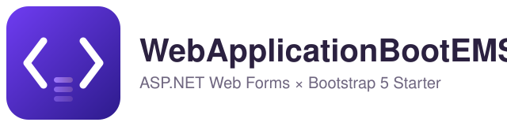
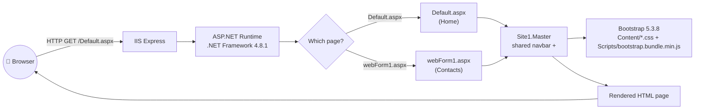
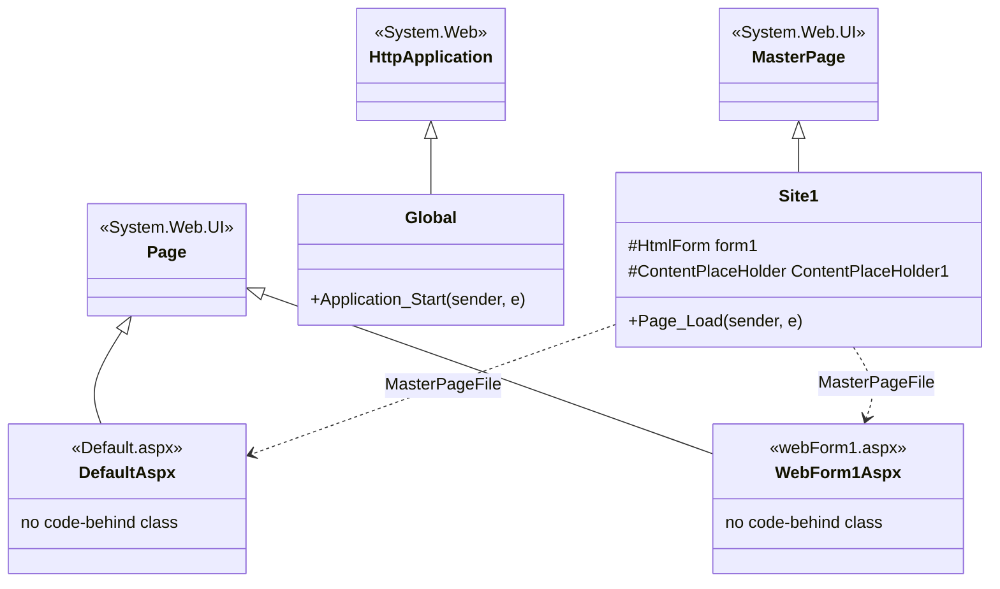
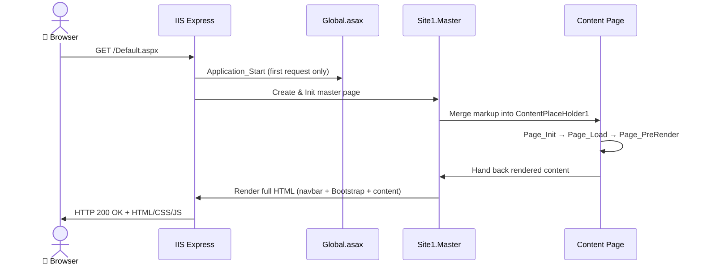
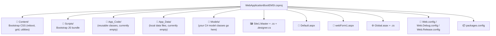
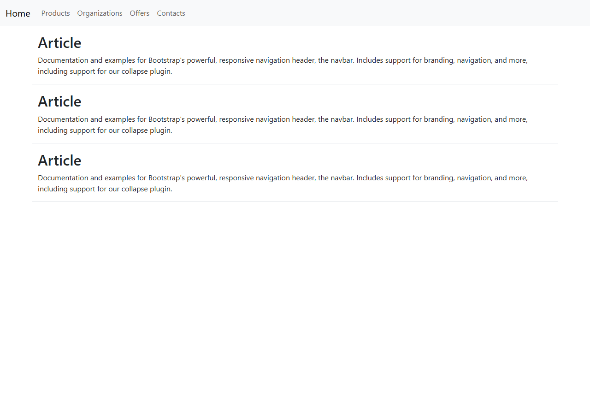
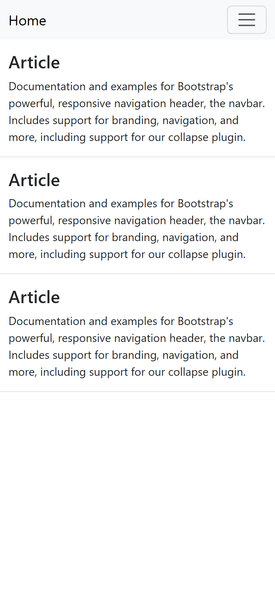
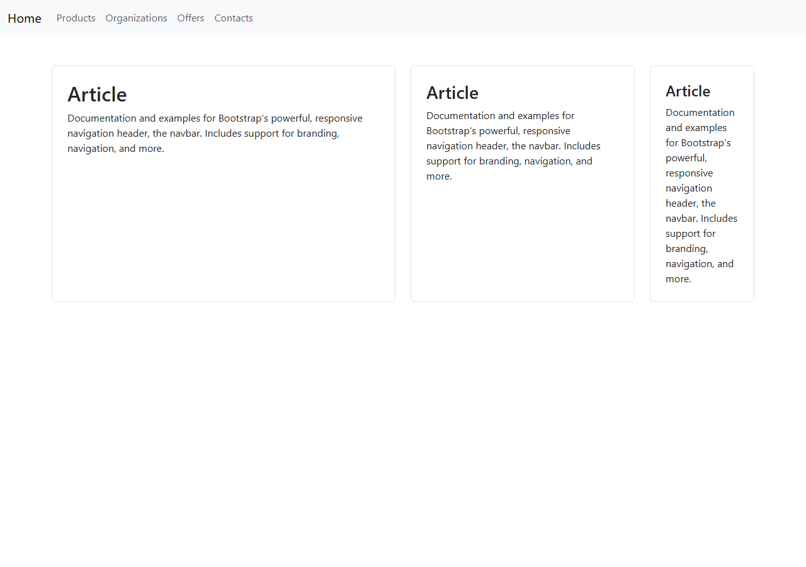

<div align="center">



### 🧩 A complete, beginner-friendly ASP.NET Web Forms + Bootstrap 5 starter

[](https://dotnet.microsoft.com/)
[](https://getbootstrap.com/)
[](https://learn.microsoft.com/aspnet/web-forms/overview/)
[](https://www.iis.net/downloads/microsoft/iis-express)
[](LICENSE)
[](#-contributing)

*A responsive ASP.NET Web Forms project demonstrating Bootstrap integration, reusable master
pages, and responsive navigation and layouts — plus a zero-to-hero tutorial for anyone who has
never opened Visual Studio before.* 🎓

</div>

---

## 🎬 Demo

<div align="center">
  
</div>

> 🖼️ The GIF above is a placeholder path. See [`assets/screenshots/README.md`](assets/screenshots/README.md)
> for the exact checklist of captures to record — drop them in and this demo comes alive.

---

## 📑 Table of Contents

- [✨ Features](#-features)
- [🛠️ Tech Stack](#️-tech-stack)
- [🏗️ Architecture (UML / Mermaid)](#️-architecture-uml--mermaid)
- [📂 Project Structure](#-project-structure)
- [🧪 Key Files Walkthrough](#-key-files-walkthrough)
- [✅ Prerequisites](#-prerequisites)
- [🚀 Quick Start (clone this repo)](#-quick-start-clone-this-repo)
- [🎓 Full Beginner Tutorial — Build This Project From Absolute Zero](#-full-beginner-tutorial--build-this-project-from-absolute-zero)
- [🖥️ Screenshots](#️-screenshots)
- [🐞 Troubleshooting](#-troubleshooting)
- [🗺️ Roadmap](#️-roadmap)
- [🤝 Contributing](#-contributing)
- [📄 License](#-license)
- [🙌 Acknowledgments](#-acknowledgments)

---

## ✨ Features

- 🧱 **Master Page layout** (`Site1.Master`) — one navbar and `<head>` shared by every page.
- 📱 **Fully responsive navbar** — Bootstrap's `navbar-expand-md` + collapse plugin, hamburger
  menu on mobile.
- 🎨 **Bootstrap 5.3.8** installed the classic ASP.NET way — via **NuGet**, not a CDN, so it's
  versioned with your project and works offline.
- 🧩 **Content pages** (`Default.aspx`, `webForm1.aspx`) that plug into the master page through
  `<asp:Content>` / `ContentPlaceHolder`.
- ⚙️ **Classic ASP.NET Web Forms pipeline** on **.NET Framework 4.8.1**, run locally with
  **IIS Express** — exactly what you'll meet in most legacy enterprise ASP.NET codebases.
- 📚 **A full "from zero" learning path** below — every click a beginner needs in Visual Studio,
  in order, with a screenshot slot for each one.

---

## 🛠️ Tech Stack

| Layer | Technology |
|---|---|
| Language | C# |
| Framework | ASP.NET Web Forms (.NET Framework **4.8.1**) |
| UI Toolkit | [Bootstrap **5.3.8**](https://getbootstrap.com/) (CSS + `bootstrap.bundle.min.js`, installed via NuGet) |
| Package manager | NuGet (`packages.config` — classic, non-SDK-style `.csproj`) |
| Local web server | IIS Express |
| IDE | Visual Studio 2022 / **Visual Studio 2026 Insiders**, workload *ASP.NET and web development* |
| Build | MSBuild (`Debug` / `Release` configurations, `Web.Debug.config` / `Web.Release.config`) |

---

## 🏗️ Architecture (UML / Mermaid)

### 1️⃣ Request / response flow



### 2️⃣ Class diagram — who inherits from what



### 3️⃣ Sequence diagram — a page's lifecycle



### 4️⃣ Folder relationships



---

## 📂 Project Structure

```text
WebApplicationBootEMSI/
├── App_Code/                      # Reusable server-side classes (empty by default)
├── App_Data/                      # Local data (e.g. SQLite/MDF files) — empty by default
├── Content/                       # Bootstrap CSS, installed via NuGet (bootstrap.min.css, grid, utilities, rtl...)
├── Models/                        # Your C# model / POCO classes
├── Properties/
│   └── AssemblyInfo.cs
├── Scripts/                       # Bootstrap JS bundle (bootstrap.bundle.min.js, esm build, source maps)
├── Default.aspx                   # Home page — content page (no code-behind)
├── Global.asax / Global.asax.cs   # Application-level events (Application_Start, …)
├── Site1.Master                   # Shared layout: <head>, Bootstrap links, responsive navbar
├── Site1.Master.cs                # Master page code-behind (Page_Load)
├── Site1.Master.designer.cs       # Auto-generated control declarations
├── webForm1.aspx                  # Second content page — content page (no code-behind)
├── Web.config                     # Main configuration (target framework, default document, compilers)
├── Web.Debug.config               # Web.config transform for Debug builds
├── Web.Release.config             # Web.config transform for Release builds
├── packages.config                # NuGet package list (bootstrap 5.3.8, Microsoft.CodeDom.Providers…)
└── WebApplicationBootEMSI.csproj  # MSBuild project file (.NET Framework 4.8.1, Web Application)
```

---

## 🧪 Key Files Walkthrough

| File | Role |
|---|---|
| **`Site1.Master`** | Defines `<head>` (viewport meta + Bootstrap CSS link), the responsive navbar (`navbar-expand-md`), and the single `<asp:ContentPlaceHolder id="ContentPlaceHolder1">` every page fills in. Bootstrap's JS bundle is loaded right before `</body>`. |
| **`Default.aspx`** | The home page. Fills `ContentPlaceHolder1` with a Bootstrap `container`/`row`/`article` layout — three stacked sections (`#emsi`, `#about`, `#contact`) linked from the navbar. |
| **`webForm1.aspx`** | The "Contacts" page. Demonstrates a responsive Bootstrap grid (`col-12 col-md-6`, `col-md-4`, `col-md-2`) with bordered card-like `article` blocks. |
| **`Global.asax.cs`** | Application entry point — `Application_Start` runs once when the app pool boots. This is where you'd register routes, bundles, or run startup logic. |
| **`packages.config`** | Declares the exact NuGet packages this project depends on: `bootstrap 5.3.8` and `Microsoft.CodeDom.Providers.DotNetCompilerPlatform 2.0.1` (lets the project compile with modern C# syntax under .NET Framework). |
| **`Web.config`** | Sets `targetFramework="4.8.1"`, the default document (`Default.aspx`), and the Roslyn C#/VB compiler providers. |

---

## ✅ Prerequisites

| Tool | Why you need it |
|---|---|
| 🪟 **Windows 10/11** | ASP.NET Web Forms (.NET Framework) + IIS Express are Windows-only. |
| 🧰 **Visual Studio 2022** *or* **Visual Studio 2026 Insiders**, Community/Professional/Enterprise edition | The IDE used to build, debug, and run this project. The *Enterprise* edition only adds extra testing/architecture tools — none of them are required here. |
| ✅ Workload: **ASP.NET and web development** | Installs the Web Forms project templates, IIS Express, and the NuGet tooling used in this guide. |
| 🌐 Git (optional) | Only needed if you want to clone this repo or push your own copy to GitHub. |

> 💡 **"Visual Studio Enterprise 2026 Insiders"** — every screen described below uses menu paths
> (*File → New → Project*, *NuGet Package Manager*, …) that are stable across the 2022 and 2026
> Insiders releases and across editions (Community/Professional/Enterprise). If a dialog looks
> slightly different on your installed build, the *goal* of each step is still the same.

---

## 🚀 Quick Start (clone this repo)

```powershell
# 1. Clone the repository
git clone https://github.com/Lagmouchyoussef/aspnet-webforms-bootstrap-starter.git
cd aspnet-webforms-bootstrap-starter

# 2. Open the solution in Visual Studio
start WebApplicationBootEMSI.slnx
```

1. Visual Studio restores NuGet packages automatically on load (or right-click the solution →
   **Restore NuGet Packages** if prompted).
2. Make sure `Default.aspx` is the start page (right-click it in Solution Explorer → **Set as
   Start Page**).
3. Press **F5** (Debug) or **Ctrl+F5** (without debugging). IIS Express launches and your
   default browser opens the home page automatically. 🎉

If you only have this README and want the *whole* project built from scratch yourself —
including every Visual Studio click — follow the full tutorial below. 👇

---

## 🎓 Full Beginner Tutorial — Build This Project From Absolute Zero

This section assumes **zero prior experience** with Visual Studio or ASP.NET. Every step tells
you exactly where to click. Each step has a screenshot slot — see
[`assets/screenshots/README.md`](assets/screenshots/README.md) for the full capture checklist
and exact filenames.

### Part A — Install your tools

**Step 1. Install Visual Studio**
Download Visual Studio (2022, or 2026 Insiders if you want the latest preview) from
[visualstudio.microsoft.com](https://visualstudio.microsoft.com/). Run the installer.

**Step 2. Select the right workload**
In the Visual Studio Installer, check **☑️ ASP.NET and web development**, then click
**Install** (or **Modify** if Visual Studio is already installed). This single workload pulls
in the Web Forms templates, IIS Express, and NuGet support you'll use in every step below.

📸 `step-01-vs-installer-workload.png`

---

### Part B — Create the project

**Step 3. Launch Visual Studio and start a new project**
On the start screen, click **Create a new project**.

**Step 4. Pick the Web Forms template**
In the search box, type `ASP.NET Web Application`. Select **ASP.NET Web Application (.NET
Framework)** — ⚠️ not "ASP.NET Core Web App" — and click **Next**.

📸 `step-02-new-project-search.png`

**Step 5. Name and locate the project**
On the *Configure your new project* screen:
- **Project name:** `WebApplicationBootEMSI` (or your own name)
- **Location:** any folder you like
- **Solution name:** leave it matching the project name

Click **Create**.

📸 `step-03-configure-project.png`

**Step 6. Choose the "Web Forms" template**
A second wizard appears asking which kind of ASP.NET project to scaffold. Select **Web Forms**
(not Empty, MVC, or Web API) and click **Create**.

📸 `step-04-webforms-template.png`

**Step 7. Look around Solution Explorer**
Visual Studio generates a starter solution with `Default.aspx`, `Site.Master`, `Web.config`,
`App_Data/`, `Scripts/`, `Content/`, etc. Take a minute to open a few files and see what the
default template looks like before you change anything.

📸 `step-05-solution-explorer.png`

---

### Part C — Install Bootstrap (the NuGet way)

**Step 8. Open the NuGet Package Manager**
Go to **Tools → NuGet Package Manager → Manage NuGet Packages for Solution…**

📸 `step-06-nuget-manage-packages.png`

**Step 9. Search and install Bootstrap**
Click the **Browse** tab, type `bootstrap`, select the official **bootstrap** package by the
Bootstrap team, pick version **5.3.8** (or latest 5.x) in the version dropdown on the right,
check your project, and click **Install**. Accept the license prompt.

📸 `step-07-nuget-bootstrap-install.png`

**Step 10. Confirm the files landed**
Expand `Content/` and `Scripts/` in Solution Explorer — you should now see `bootstrap.min.css`,
`bootstrap.css`, the RTL and grid/utilities variants, and `bootstrap.bundle.min.js` under
`Scripts/`. Open `packages.config` and confirm a `<package id="bootstrap" version="5.3.8" .../>`
entry was added automatically.

📸 `step-08-content-scripts-folders.png`

---

### Part D — Build the shared layout (Master Page)

**Step 11. Open the Master Page**
Double-click `Site1.Master` (Visual Studio names it `Site1.Master` or `Site.Master` depending
on the template version).

**Step 12. Link Bootstrap in `<head>`**
Inside the `<head runat="server">` block, add:

```aspx
<link href="<%= ResolveUrl("~/Content/bootstrap.min.css") %>" rel="stylesheet" />
```

**Step 13. Build a responsive navbar**
Inside `<form id="form1" runat="server">`, above the `<asp:ContentPlaceHolder>`, paste a
Bootstrap navbar — a `<nav class="navbar navbar-expand-md navbar-light bg-light py-2">`
containing a brand link, a `navbar-toggler` button (the mobile hamburger), and a
`collapse navbar-collapse` list of `<a class="nav-link">` items pointing at your pages.

**Step 14. Load the Bootstrap JS bundle**
Just before `</body>`, add:

```aspx
<script src="<%= ResolveUrl("~/Scripts/bootstrap.bundle.min.js") %>"></script>
```

This single bundle powers the navbar's collapse/hamburger behavior — no jQuery required.

📸 `step-09-sitemaster-markup.png`

---

### Part E — Build the content pages

**Step 15. Fill in the home page**
Open `Default.aspx`. Inside the existing `<asp:Content ContentPlaceHolderID="ContentPlaceHolder1">`,
lay out your content with Bootstrap's grid: a `container`, a `row`, and `col-*` articles/sections.

📸 `step-10-default-aspx-markup.png`

**Step 16. Add a second page**
Right-click the project in Solution Explorer → **Add → New Item… → Web Form**. Name it
`webForm1.aspx` and click **Add**.

📸 `step-11-add-web-form-dialog.png`

**Step 17. Wire it to the Master Page**
Make sure the generated `@Page` directive includes `MasterPageFile="~/Site1.Master"`, then fill
its `<asp:Content>` with a second Bootstrap layout (e.g. a `row g-4` of bordered cards).

**Step 18. Link it from the navbar**
Back in `Site1.Master`, add a nav item pointing at
`<%= ResolveUrl("~/webForm1.aspx") %>` so users can reach the new page.

---

### Part F — Run and debug

**Step 19. Set the start page**
Right-click `Default.aspx` in Solution Explorer → **Set as Start Page**.

📸 `step-12-set-as-start-page.png`

**Step 20. Press F5**
Click the green ▶ **IIS Express** button (or press **F5**). Visual Studio compiles the project,
starts IIS Express, and opens your default browser automatically.

📸 `step-13-run-iis-express.png`

**Step 21. Check the result**
Your home page should load with the Bootstrap navbar at full width.

📸 `step-14-browser-home.png`

**Step 22. Test responsiveness**
Shrink the browser window (or open DevTools' device toolbar, `Ctrl+Shift+M`). Below the `md`
breakpoint, the nav links collapse behind a ☰ hamburger button — click it to confirm the
collapse animation works.

📸 `step-15-browser-navbar-collapsed.png`

**Step 23. Navigate to the second page**
Click the **Contacts** link (or whatever you named it) and confirm `webForm1.aspx` renders
through the same Master Page.

📸 `step-16-browser-webform1.png`

**Step 24. Set a breakpoint and debug**
Open `Site1.Master.cs`, click in the gutter next to `Page_Load` to set a breakpoint (**F9**),
then press **F5** again. Visual Studio pauses execution there on every request — inspect
variables, step through code with **F10**/**F11**.

📸 `step-17-debug-breakpoint.png`

---

### Part G — Build for Release and ship it

**Step 25. Switch to Release configuration**
In the toolbar dropdown, change **Debug** to **Release**.

**Step 26. Build the solution**
**Build → Build Solution** (or **Ctrl+Shift+B**). Watch the *Output* window for
`Build succeeded`.

📸 `step-18-release-build-output.png`

**Step 27. Publish (optional)**
Right-click the project → **Publish…** to deploy to IIS, Azure App Service, or a folder, using
the `Web.Release.config` transform automatically.

---

### Part H — Save your work with Git

**Step 28. Initialize and push**

```powershell
git init
git add .
git commit -m "Initial commit: ASP.NET Web Forms + Bootstrap starter"
git branch -M main
git remote add origin https://github.com/<your-username>/<your-repo>.git
git push -u origin main
```

📸 `step-19-git-push.png`

🎉 **Congratulations — you just built, ran, debugged, and published a professional ASP.NET Web
Forms + Bootstrap project from a completely empty Visual Studio install.**

---

## 🖥️ Screenshots

| Home page (desktop) | Navbar collapsed (mobile) | Contacts page |
|---|---|---|
|  |  |  |

> See [`assets/screenshots/README.md`](assets/screenshots/README.md) for the full capture
> checklist referenced throughout this README.

---

## 🐞 Troubleshooting

| Symptom | Likely cause | Fix |
|---|---|---|
| ❌ `Could not load file or assembly 'Microsoft.CodeDom.Providers...'` | NuGet packages weren't restored | Right-click the solution → **Restore NuGet Packages**, then rebuild |
| ❌ Bootstrap classes have no effect (page looks unstyled) | The `<link>`/`<script>` paths don't resolve | Confirm you used `ResolveUrl("~/Content/bootstrap.min.css")` and `~/Scripts/bootstrap.bundle.min.js`, and that the files exist under `Content/`/`Scripts/` |
| ❌ Browser shows "Unable to connect" / blank page on F5 | IIS Express didn't start, or the SSL dev certificate isn't trusted | Re-run Visual Studio as the same Windows user that installed it; accept the "Trust the IIS Express SSL certificate?" prompt the first time you debug |
| ❌ Navbar hamburger button does nothing | Bootstrap's JS bundle isn't loaded, or is loaded *before* the DOM elements exist | Make sure `bootstrap.bundle.min.js` is referenced right before `</body>`, after all navbar markup |
| ❌ `Default.aspx` isn't the page that opens on F5 | A different page is set as the start page | Right-click the desired page → **Set as Start Page** |
| ❌ Mermaid diagrams above don't render | You're viewing this file somewhere other than GitHub/GitLab (or an old renderer) | Open the file on GitHub, or view it in an editor with Mermaid preview support (e.g. VS Code + "Markdown Preview Mermaid Support" extension) |

---

## 🗺️ Roadmap

- [ ] Move to a modern layout (`master` → ASP.NET Core Razor Pages) as a side-by-side learning comparison
- [ ] Add a sample `Models/` entity + a data-bound `GridView`/`Repeater` page
- [ ] Add automated UI smoke tests (e.g. Playwright) against IIS Express
- [ ] Record and commit the real screenshots/GIF from the checklist above

---

## 🤝 Contributing

Contributions, issues, and suggestions are welcome!

1. Fork the repo
2. Create a feature branch: `git checkout -b feature/my-improvement`
3. Commit your changes: `git commit -m "Add my improvement"`
4. Push the branch: `git push origin feature/my-improvement`
5. Open a Pull Request

---

## 📄 License

This project is licensed under the **MIT License** — see [`LICENSE`](LICENSE) for details.

---

## 🙌 Acknowledgments

- [Bootstrap](https://getbootstrap.com/) for the responsive component library
- [Microsoft Learn — ASP.NET Web Forms](https://learn.microsoft.com/aspnet/web-forms/overview/) documentation
- EMSI — *4IIR G9/G92* ASP.NET coursework that this starter was built for 🎓

<div align="center">

Made with 💜 by [**Lagmouchyoussef**](https://github.com/Lagmouchyoussef)

</div>
