<div align="center">


### 🧩 A complete, beginner-friendly ASP.NET Web Forms + Bootstrap 5 starter

[](https://dotnet.microsoft.com/)
[](https://getbootstrap.com/)
[](https://learn.microsoft.com/aspnet/web-forms/overview/)
[](https://www.iis.net/downloads/microsoft/iis-express)
[](LICENSE)
[](#-contributing)

*A responsive ASP.NET Web Forms project demonstrating Bootstrap integration, reusable master
pages, and responsive navigation and layouts — plus a zero-to-hero tutorial for anyone who has
never opened Visual Studio before.* 🎓

</div>

---

## 🎬 Demo

<div align="center">
  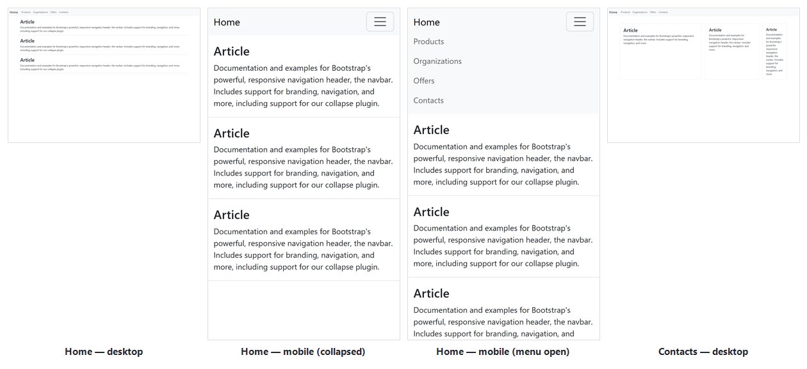
</div>

> 🖼️ These four panels are **real captures of this exact repository**, taken by building the
> project with MSBuild, serving it with IIS Express, and rendering it in headless Chrome driven
> over the DevTools protocol (including an actual click on the hamburger button for the "menu
> open" panel). No mockups.

---

## 📑 Table of Contents

- [✨ Features](#-features)
- [🛠️ Tech Stack](#️-tech-stack)
- [🏗️ Architecture (UML / Mermaid)](#️-architecture-uml--mermaid)
- [📂 Project Structure](#-project-structure)
- [🧪 Key Files Walkthrough](#-key-files-walkthrough)
- [✅ Prerequisites](#-prerequisites)
- [🚀 Quick Start (clone this repo)](#-quick-start-clone-this-repo)
- [🎓 Full Beginner Tutorial — Build This Project From Absolute Zero](#-full-beginner-tutorial--build-this-project-from-absolute-zero)
- [🖥️ Screenshots](#️-screenshots)
- [🐞 Troubleshooting](#-troubleshooting)
- [🗺️ Roadmap](#️-roadmap)
- [🤝 Contributing](#-contributing)
- [📄 License](#-license)
- [🙌 Acknowledgments](#-acknowledgments)

---

## ✨ Features

- 🧱 **Master Page layout** (`Site1.Master`) — one navbar and `<head>` shared by every page.
- 📱 **Fully responsive navbar** — Bootstrap's `navbar-expand-md` + collapse plugin, hamburger
  menu on mobile.
- 🎨 **Bootstrap 5.3.8** installed the classic ASP.NET way — via **NuGet**, not a CDN, so it's
  versioned with your project and works offline.
- 🧩 **Content pages** (`Default.aspx`, `webForm1.aspx`) that plug into the master page through
  `<asp:Content>` / `ContentPlaceHolder`.
- ⚙️ **Classic ASP.NET Web Forms pipeline** on **.NET Framework 4.8.1**, run locally with
  **IIS Express** — exactly what you'll meet in most legacy enterprise ASP.NET codebases.
- 📚 **A full "from zero" learning path** below — every click a beginner needs in Visual Studio,
  in order, with a real screenshot for nearly every step (sourced from the EMSI workshop this
  project follows, plus live captures of this repo actually running).

---

## 🛠️ Tech Stack

| Layer | Technology |
|---|---|
| Language | C# |
| Framework | ASP.NET Web Forms (.NET Framework **4.8.1**) |
| UI Toolkit | [Bootstrap **5.3.8**](https://getbootstrap.com/) (CSS + `bootstrap.bundle.min.js`, installed via NuGet) |
| Package manager | NuGet (`packages.config` — classic, non-SDK-style `.csproj`) |
| Local web server | IIS Express |
| IDE | Visual Studio 2022 / **Visual Studio 2026 Insiders**, workload *ASP.NET and web development* |
| Build | MSBuild (`Debug` / `Release` configurations, `Web.Debug.config` / `Web.Release.config`) |

---

## 🏗️ Architecture (UML / Mermaid)

### 1️⃣ Request / response flow

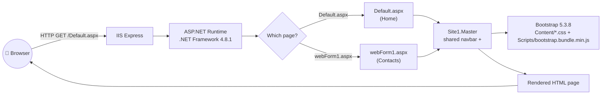

### 2️⃣ Class diagram — who inherits from what

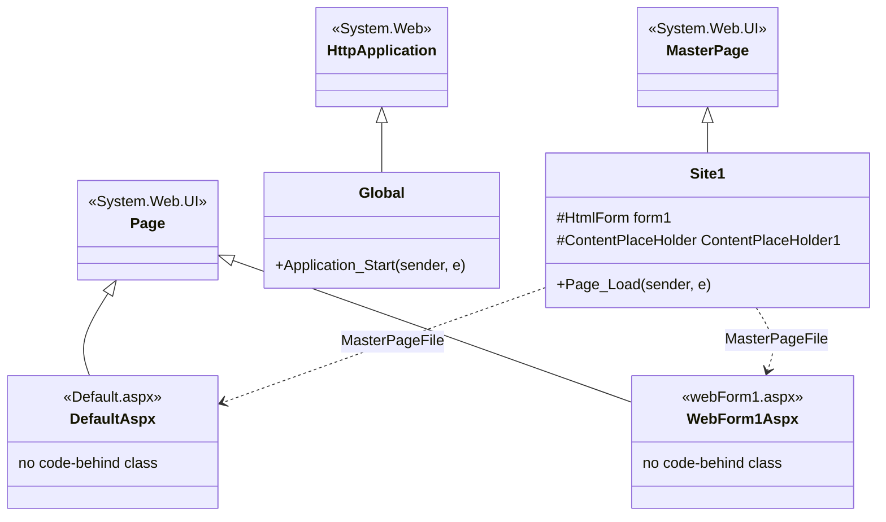

### 3️⃣ Sequence diagram — a page's lifecycle

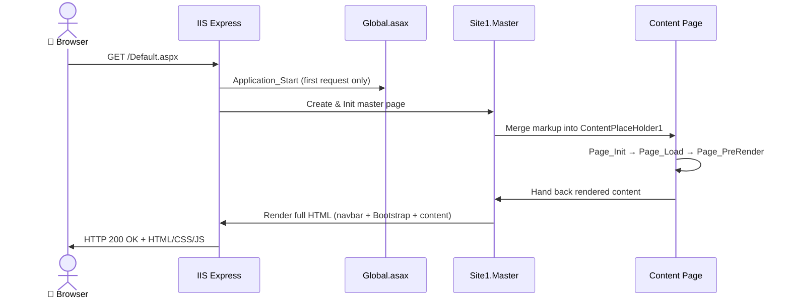

### 4️⃣ Folder relationships

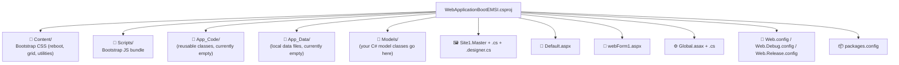

---

## 📂 Project Structure

```text
WebApplicationBootEMSI/
├── App_Code/                      # Reusable server-side classes (empty by default)
├── App_Data/                      # Local data (e.g. SQLite/MDF files) — empty by default
├── Content/                       # Bootstrap CSS, installed via NuGet (bootstrap.min.css, grid, utilities, rtl...)
├── Models/                        # Your C# model / POCO classes
├── Properties/
│   └── AssemblyInfo.cs
├── Scripts/                       # Bootstrap JS bundle (bootstrap.bundle.min.js, esm build, source maps)
├── Default.aspx                   # Home page — content page (no code-behind)
├── Global.asax / Global.asax.cs   # Application-level events (Application_Start, …)
├── Site1.Master                   # Shared layout: <head>, Bootstrap links, responsive navbar
├── Site1.Master.cs                # Master page code-behind (Page_Load)
├── Site1.Master.designer.cs       # Auto-generated control declarations
├── webForm1.aspx                  # Second content page — content page (no code-behind)
├── Web.config                     # Main configuration (target framework, default document, compilers)
├── Web.Debug.config               # Web.config transform for Debug builds
├── Web.Release.config             # Web.config transform for Release builds
├── packages.config                # NuGet package list (bootstrap 5.3.8, Microsoft.CodeDom.Providers…)
└── WebApplicationBootEMSI.csproj  # MSBuild project file (.NET Framework 4.8.1, Web Application)
```

---

## 🧪 Key Files Walkthrough

| File | Role |
|---|---|
| **`Site1.Master`** | Defines `<head>` (viewport meta + Bootstrap CSS link), the responsive navbar (`navbar-expand-md`), and the single `<asp:ContentPlaceHolder id="ContentPlaceHolder1">` every page fills in. Bootstrap's JS bundle is loaded right before `</body>`. |
| **`Default.aspx`** | The home page. Fills `ContentPlaceHolder1` with a Bootstrap `container`/`row`/`article` layout — three stacked sections (`#emsi`, `#about`, `#contact`) linked from the navbar. |
| **`webForm1.aspx`** | The "Contacts" page. Demonstrates a responsive Bootstrap grid (`col-12 col-md-6`, `col-md-4`, `col-md-2`) with bordered card-like `article` blocks. |
| **`Global.asax.cs`** | Application entry point — `Application_Start` runs once when the app pool boots. This is where you'd register routes, bundles, or run startup logic. |
| **`packages.config`** | Declares the exact NuGet packages this project depends on: `bootstrap 5.3.8` and `Microsoft.CodeDom.Providers.DotNetCompilerPlatform 2.0.1` (lets the project compile with modern C# syntax under .NET Framework). |
| **`Web.config`** | Sets `targetFramework="4.8.1"`, the default document (`Default.aspx`), and the Roslyn C#/VB compiler providers. |

---

## ✅ Prerequisites

| Tool | Why you need it |
|---|---|
| 🪟 **Windows 10/11** | ASP.NET Web Forms (.NET Framework) + IIS Express are Windows-only. |
| 🧰 **Visual Studio 2022** *or* **Visual Studio 2026 Insiders**, Community/Professional/Enterprise edition | The IDE used to build, debug, and run this project. The *Enterprise* edition only adds extra testing/architecture tools — none of them are required here. |
| ✅ Workload: **ASP.NET and web development** | Installs the Web Forms project templates, IIS Express, and the NuGet tooling used in this guide. |
| 🌐 Git (optional) | Only needed if you want to clone this repo or push your own copy to GitHub. |

> 💡 **"Visual Studio Enterprise 2026 Insiders"** — every screen described below uses menu paths
> (*File → New → Project*, *NuGet Package Manager*, …) that are stable across the 2022 and 2026
> Insiders releases and across editions (Community/Professional/Enterprise). If a dialog looks
> slightly different on your installed build, the *goal* of each step is still the same.

---

## 🚀 Quick Start (clone this repo)

This repository contains the **full, real project** — not just documentation. Cloning it gives
you the exact same `WebApplicationBootEMSI` solution described throughout this README.

```powershell
# 1. Clone the repository
git clone https://github.com/Lagmouchyoussef/aspnet-webforms-bootstrap-starter.git
cd aspnet-webforms-bootstrap-starter

# 2. Open the solution in Visual Studio
start WebApplicationBootEMSI.slnx
```

1. Visual Studio restores the NuGet packages listed in `packages.config` automatically on load
   (or right-click the solution → **Restore NuGet Packages** if prompted). This recreates the
   `packages/` folder (bootstrap 5.3.8 + the Roslyn compiler provider) that isn't committed to
   Git.
2. Make sure `Default.aspx` is the start page (right-click it in Solution Explorer → **Set as
   Start Page**).
3. Press **F5** (Debug) or **Ctrl+F5** (without debugging). IIS Express launches and your
   default browser opens the home page automatically. 🎉

You can also build it headlessly from a terminal, exactly as was done to produce the screenshots
in this README:

```powershell
& "C:\Program Files\Microsoft Visual Studio\18\Insiders\MSBuild\Current\Bin\amd64\MSBuild.exe" `
  "WebApplicationBootEMSI.csproj" /p:Configuration=Debug

& "C:\Program Files\IIS Express\iisexpress.exe" /path:"$PWD" /port:52345
# then open http://localhost:52345/Default.aspx
```

> 💡 Adjust the `MSBuild.exe` path above to match your own Visual Studio edition/year — the
> folder segment (`18\Insiders`, `2022\Community`, …) differs per install.

If you only have this README and want to understand *how the whole project was built from
scratch*, including every Visual Studio click, follow the full tutorial below. 👇

---

## 🎓 Full Beginner Tutorial — Build This Project From Absolute Zero

This section assumes **zero prior experience** with Visual Studio or ASP.NET. It documents the
*exact* sequence used to build **this repository**, based on the EMSI workshops
**"02 - Bootstrap ASP.NET 2022"** and **"04 - UI Design with Bootstrap"**. Every IDE screenshot
below (steps 1–10) is a **real capture from that workshop**, taken while building this very
project (`WebApplicationBootEMSI`) — not a stock image. Steps 11+ are **real captures of this
repository actually running**, produced by building it with MSBuild and serving it with IIS
Express (see [`assets/screenshots/README.md`](assets/screenshots/README.md) for how the handful
of remaining IDE-interaction screenshots — installer, breakpoint, Release build output, git push
— can be added; they require live desktop access this environment doesn't have).

### Part A — Install your tools

Download **Visual Studio** (2022, or 2026 Insiders — this repo was built with **Visual Studio
2026 Insiders**, `devenv.exe` under `...\Microsoft Visual Studio\18\Insiders\`) from
[visualstudio.microsoft.com](https://visualstudio.microsoft.com/). In the Visual Studio
Installer, check **☑️ ASP.NET and web development**, then **Install** (or **Modify** if already
installed). This workload brings the Web Forms templates, IIS Express, and NuGet tooling used
below.

---

### Part B — Create the project (Empty ASP.NET template + Web Forms references)

**Step 1. New Project → search "ASP.NET"**
On the Visual Studio start screen, click **Create a new project**, then search for
`ASP.NET Web Application`. Pick **Application web ASP.NET (.NET Framework)**.

📸 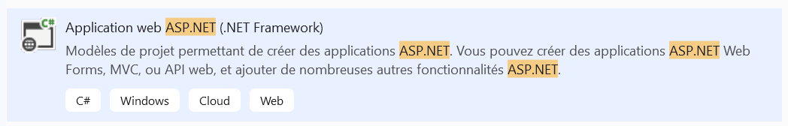

**Step 2. Pick "Vide" (Empty) + check "Web Forms"**
On the **Create an ASP.NET Web Application** screen, select the **Vide / Empty** template on the
left (it starts with no pre-generated pages), then under *Add folders and core references* on
the right, check **☑️ Web Forms**. Leave Authentication at **None**. This is deliberate: starting
empty forces you to add the Master Page and Bootstrap yourself, rather than inheriting a
prebuilt template — exactly what this workshop (and this repo) teaches.

📸 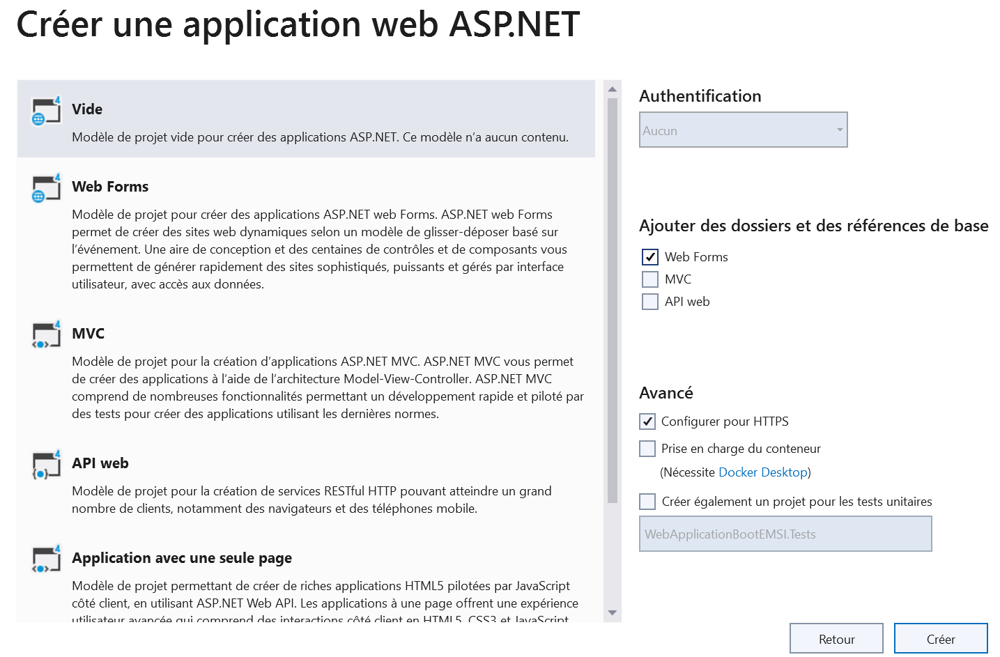

**Step 3. Look at Solution Explorer**
The generated solution is intentionally minimal: `App_Data/`, `Models/`, `Global.asax`,
`packages.config`, `Web.config` — no pages, no CSS yet.

📸 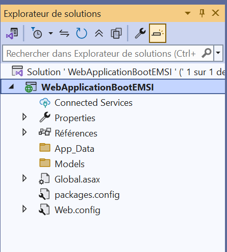

---

### Part C — Create the Master Page

**Step 4. Add → New Item → Web Forms Master Page**
Right-click the project → **Add → New Item…**, open the **Web** category, select **Page maître
Web Forms / Web Forms Master Page**, name it `Site1.Master`, and click **Add**.

📸 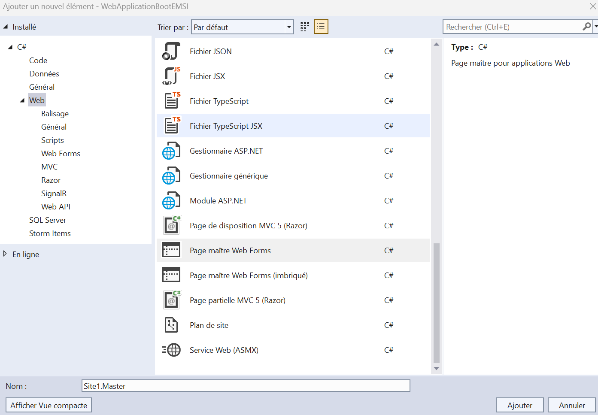

> In ASP.NET Web Forms, a **Master Page** defines the layout shared by every page — header,
> navigation, `<head>` — once. Individual **content pages** then plug their own markup into a
> `ContentPlaceHolder` the Master Page exposes, and ASP.NET merges the two at request time.

---

### Part D — Install Bootstrap via NuGet

**Step 5. Manage NuGet Packages → search "bootstrap" → Install**
Right-click the project → **Manage NuGet Packages…**, open the **Parcourir / Browse** tab,
search `bootstrap`, select the official **bootstrap** package (publisher `mdo, Supergibbs,
twbs`), pick version **5.3.8** from the version dropdown, and click **Install**. Accept the
license prompt.

📸 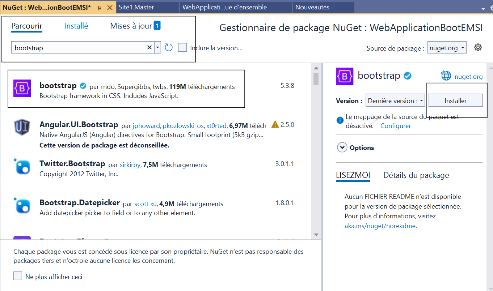

**Step 6. Confirm the generated folders**
Two new folders appear: **`Content/`** (Bootstrap's CSS) and **`Scripts/`** (Bootstrap's JS
bundle). `packages.config` now lists `bootstrap 5.3.8` automatically.

📸 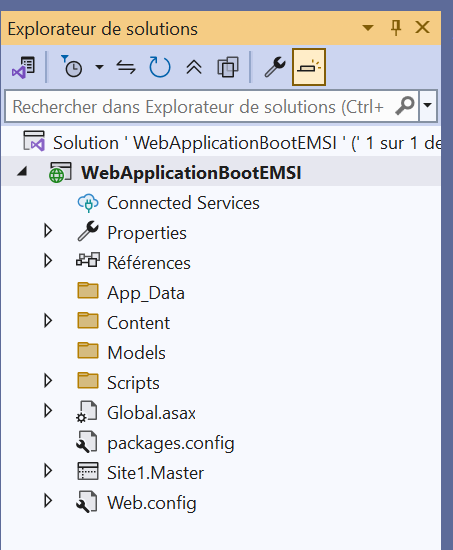

---

### Part E — Build the shared layout

**Step 7. Link Bootstrap and build the navbar in `Site1.Master`**
Open `Site1.Master` and, inside `<head runat="server">`, reference the stylesheet:

```aspx
<link href="<%= ResolveUrl("~/Content/bootstrap.min.css") %>" rel="stylesheet" />
```

Inside `<form id="form1" runat="server">`, above the `<asp:ContentPlaceHolder>`, add a
responsive Bootstrap navbar (`navbar navbar-expand-md navbar-light bg-light`) with a brand link,
a `navbar-toggler` button, and a `collapse navbar-collapse` list of nav links. Just before
`</body>`, load the JS bundle:

```aspx
<script src="<%= ResolveUrl("~/Scripts/bootstrap.bundle.min.js") %>"></script>
```

This single bundle (no jQuery needed) powers the navbar's collapse/hamburger behavior. The
Design view confirms the navbar renders above the empty content area:

📸 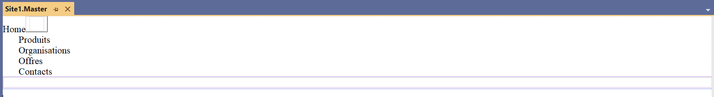

*(This is exactly the markup in [`Site1.Master`](Site1.Master) in this repo — navbar links
renamed to **Products / Organizations / Offers / Contacts**.)*

---

### Part F — Create the content pages

**Step 8. Add → New Item → Web Form *with* Master Page**
Right-click the project → **Add → New Item…** → **Web Form avec page maître / Web Form with
Master Page**. Name it (this repo uses `Default.aspx` for the home page, and later
`webForm1.aspx` for a second page).

📸 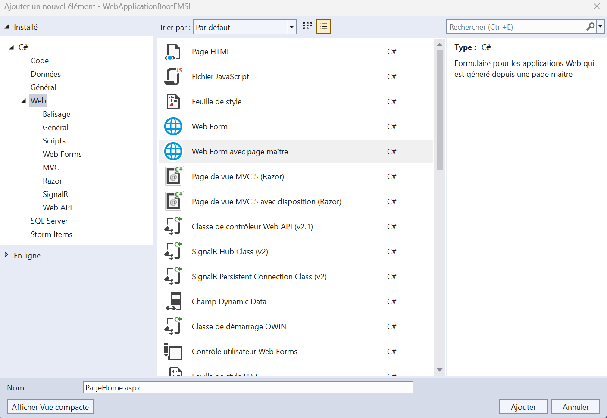

**Step 9. Pick the Master Page**
A second dialog asks which Master Page to bind to. Select **Site1.Master** → **OK**.

📸 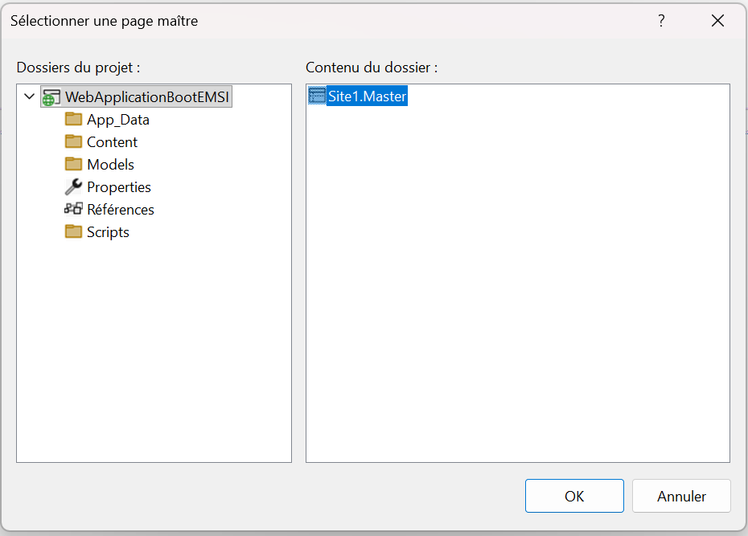

**Step 10. Fill the content page**
Visual Studio scaffolds the `@Page` directive with `MasterPageFile="~/Site1.Master"` and an
empty `<asp:Content ContentPlaceHolderID="ContentPlaceHolder1">`. Switch to **Design** view to
confirm the navbar now wraps your new page:

📸 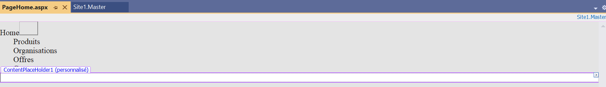

Fill the content with Bootstrap's 12-column grid — a `container`, a `row`, and `col-*` articles
(`col-12 col-md-6`, `col-md-4`, `col-md-2`, …). Repeat this step for a second page
(`webForm1.aspx` in this repo) and link both pages from the navbar in `Site1.Master` using
`<%= ResolveUrl("~/PageName.aspx") %>`.

---

### Part G — Run it and see the real result

**Step 11. Set the start page, then press F5**
Right-click `Default.aspx` → **Set as Start Page**, then press **F5** (or **Ctrl+F5**). Visual
Studio builds the project, launches **IIS Express**, and opens your default browser.

The screenshots below are **real captures of this repository** — built with MSBuild and served
by IIS Express exactly as F5 would do it:

| Desktop | Mobile — collapsed | Mobile — menu open |
|---|---|---|
|  |  | 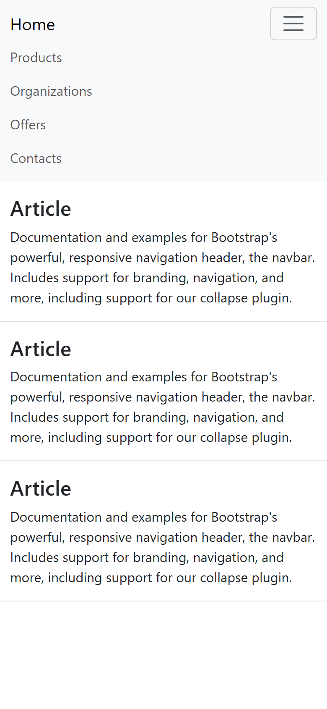 |

**Step 12. Navigate to the second page**
Click **Contacts** in the navbar to confirm `webForm1.aspx` renders through the same Master
Page, with its own Bootstrap grid of cards:

📸 

---

### Part H — Debug, build for Release, and ship it

These last steps need an interactive Visual Studio session to capture, so no screenshot is
attached yet — see [`assets/screenshots/README.md`](assets/screenshots/README.md) if you want to
add your own.

- **Debug:** open `Site1.Master.cs`, click the gutter next to `Page_Load` to set a breakpoint
  (**F9**), then **F5** again — Visual Studio pauses there on every request.
- **Release build:** switch the toolbar's configuration dropdown from **Debug** to **Release**,
  then **Build → Build Solution** (**Ctrl+Shift+B**); watch the *Output* window for
  `Build succeeded`.
- **Publish:** right-click the project → **Publish…** to deploy to IIS, Azure App Service, or a
  folder, applying the `Web.Release.config` transform automatically.
- **Push to GitHub:**
  ```powershell
  git init
  git add .
  git commit -m "Initial commit: ASP.NET Web Forms + Bootstrap starter"
  git branch -M main
  git remote add origin https://github.com/<your-username>/<your-repo>.git
  git push -u origin main
  ```

🎉 **Congratulations — you just built, ran, and understood a professional ASP.NET Web Forms +
Bootstrap project from a completely empty Visual Studio install.**

---

## 🖥️ Screenshots

All screenshots in this README are real — either captured from this exact repository running
locally, or sourced from the EMSI workshop this project was built from. None are stock images or
mockups.

**App running (this repo, live-rendered):**

| Home — desktop | Home — mobile (collapsed) | Home — mobile (menu open) | Contacts — desktop |
|---|---|---|---|
|  |  |  |  |

**Visual Studio, building this project (from the EMSI workshop):**

| New project | Empty + Web Forms | NuGet → Bootstrap | Add New Item → Web Form w/ Master |
|---|---|---|---|
|  |  |  |  |

> See the [full tutorial](#-full-beginner-tutorial--build-this-project-from-absolute-zero) above
> for all 10 IDE screenshots in sequence, and
> [`assets/screenshots/README.md`](assets/screenshots/README.md) for the few remaining
> interactive-only captures (installer, breakpoint debug, Release build output, git push) that
> still need a live desktop session to record.

---

## 🐞 Troubleshooting

| Symptom | Likely cause | Fix |
|---|---|---|
| ❌ `Could not load file or assembly 'Microsoft.CodeDom.Providers...'` | NuGet packages weren't restored | Right-click the solution → **Restore NuGet Packages**, then rebuild |
| ❌ Bootstrap classes have no effect (page looks unstyled) | The `<link>`/`<script>` paths don't resolve | Confirm you used `ResolveUrl("~/Content/bootstrap.min.css")` and `~/Scripts/bootstrap.bundle.min.js`, and that the files exist under `Content/`/`Scripts/` |
| ❌ Browser shows "Unable to connect" / blank page on F5 | IIS Express didn't start, or the SSL dev certificate isn't trusted | Re-run Visual Studio as the same Windows user that installed it; accept the "Trust the IIS Express SSL certificate?" prompt the first time you debug |
| ❌ Navbar hamburger button does nothing | Bootstrap's JS bundle isn't loaded, or is loaded *before* the DOM elements exist | Make sure `bootstrap.bundle.min.js` is referenced right before `</body>`, after all navbar markup |
| ❌ `Default.aspx` isn't the page that opens on F5 | A different page is set as the start page | Right-click the desired page → **Set as Start Page** |
| ❌ Mermaid diagrams above don't render | You're viewing this file somewhere other than GitHub/GitLab (or an old renderer) | Open the file on GitHub, or view it in an editor with Mermaid preview support (e.g. VS Code + "Markdown Preview Mermaid Support" extension) |

---

## 🗺️ Roadmap

- [ ] Move to a modern layout (`master` → ASP.NET Core Razor Pages) as a side-by-side learning comparison
- [ ] Add a sample `Models/` entity + a data-bound `GridView`/`Repeater` page
- [ ] Add automated UI smoke tests (e.g. Playwright) against IIS Express
- [ ] Capture the 4 remaining interactive-only screenshots (installer, breakpoint, Release build
      output, git push) listed in [`assets/screenshots/README.md`](assets/screenshots/README.md)

---

## 🤝 Contributing

Contributions, issues, and suggestions are welcome!

1. Fork the repo
2. Create a feature branch: `git checkout -b feature/my-improvement`
3. Commit your changes: `git commit -m "Add my improvement"`
4. Push the branch: `git push origin feature/my-improvement`
5. Open a Pull Request

---

## 📄 License

This project is licensed under the **MIT License** — see [`LICENSE`](LICENSE) for details.

---

## 🙌 Acknowledgments

- [Bootstrap](https://getbootstrap.com/) for the responsive component library
- [Microsoft Learn — ASP.NET Web Forms](https://learn.microsoft.com/aspnet/web-forms/overview/) documentation
- EMSI — *4IIR G9/G92* ASP.NET coursework. The step-by-step tutorial above follows the workshops
  **"02 - Bootstrap ASP.NET 2022"** and **"04 - UI Design with Bootstrap"**, whose Visual Studio
  screenshots (steps 1–10) are reproduced here as the authoritative reference for this exact
  project 🎓

<div align="center">

Made with 💜 by [**Lagmouchyoussef**](https://github.com/Lagmouchyoussef)

</div>
